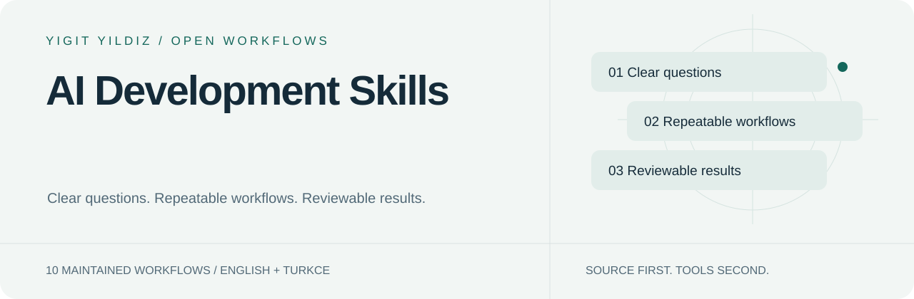

<picture>
  <source media="(prefers-color-scheme: dark)" srcset="assets/hero-dark.svg">
  
</picture>

# AI Development Skills

[English](README.md) · [Türkçe](README.tr.md)

**Yazılım geliştirme, AI araçları, güncel dokümantasyon ve kod tabanını anlama iş akışları.**

10 bakımı sürdürülen giriş noktası. Göreve göre birini seç; tüm kütüphaneyi bağlama yükleme.

[Başla](docs/INSTALL.md) · [Katalog](https://yigityildiz0.github.io/universal-ai-skill-library/) · [İndirmeler](DOWNLOADS.md) · [Bakım modeli](MAINTAINING.md)

## Yapmak istediğin işi seç

<strong>Günlük işler</strong> · 2

| Skill | Ne işe yarar? |
|---|---|
| [caveman](docs/skills/caveman.tr.md) | Kısa iletişim için resmî Caveman, Ultracave ve Megacave modlarını kullanır. |
| [personal-tech-copilot](docs/skills/personal-tech-copilot.tr.md) | Günlük cihaz, uygulama ve kurulum sorunlarını mevcut araçlarla giderir. |

<strong>Yazılım geliştirme</strong> · 6

| Skill | Ne işe yarar? |
|---|---|
| [ai-agent-builder](docs/skills/ai-agent-builder.tr.md) | Skill, ajan iş akışı ve MCP entegrasyonu geliştirir, inceler ve bakımını yapar. |
| [coding-workflow](docs/skills/coding-workflow.tr.md) | Kod sorununu kapsamı belli uygulamaya ve doğrulanmış sonuca dönüştürür. |
| [context7-mcp](docs/skills/context7-mcp.tr.md) | Mevcut Context7 entegrasyonuyla güncel kütüphane dokümanına ulaşır. |
| [find-docs](docs/skills/find-docs.tr.md) | Yetkili doküman kaynağını ve doğru sürümü bulur. |
| [graphify](docs/skills/graphify.tr.md) | Bilgi grafıyla kod, belge ve araştırma arasındaki ilişkileri anlamaya yardımcı olur. |
| [modern-web-guidance](docs/skills/modern-web-guidance.tr.md) | Mevcut projeye yeni stack dayatmadan güncel web yaklaşımları seçer. |

<strong>Araştırma ve analiz</strong> · 2

| Skill | Ne işe yarar? |
|---|---|
| [ai-research-skills](docs/skills/ai-research-skills.tr.md) | Eğitim, RAG, değerlendirme ve deneyler için geniş ML mühendisliği kütüphanesini yönlendirir. |
| [primary-source-research](docs/skills/primary-source-research.tr.md) | Resmî belge, spesifikasyon, kaynak kodu ve birincil kayıtlardan yanıt üretir. |

## Bir skill nasıl çalışır?

~~~mermaid
flowchart LR
 A[Your goal] --> B[Match the skill]
 B --> C[Load relevant module]
 C --> D[Use available tools]
 D --> E[Verify and explain]
~~~

Bu bir iş akışıdır; araç çalıştırıldığı veya bütün sonuçların doğrulandığı iddiası değildir. Her skill sayfasında örnek istek, tetikleme, mekanik, girdi/çıktı ve kaynak modüller var.

## Tek kaynak, kalıcı koleksiyonlar

Ana kaynak [Universal AI Skill Library](https://github.com/yigityildiz0/universal-ai-skill-library). Alan depoları aynı sürümün seçilmiş görünümleridir; ayrı ayrı çatallanıp elle düzenlenmez. Mevcut bağlantılar ve geçmiş korunur.

[All collections / Tüm koleksiyonlar](COLLECTIONS.md) · [Legacy/community resources](LEGACY.md) · [Licenses & provenance](docs/LICENSE-SCOPE.md)

## Dürüst kapsam

- Skill kurmak model eğitmek veya hesap/araç bağlamak değildir.
- Yerel dosya ile web hesabına yükleme farklıdır; desteklenen host akışını kullan.
- Ek ücretli API veya model indirme otomatik yapılmaz.
- Eski topluluk kataloğu güncel giriş noktalarının sayısına veya test iddiasına dahil değildir.
- Kaynak lisansları korunur; bütün üçüncü taraf içeriğine tek lisans varsayılmaz.

---
Maintained by [Yigit Yildiz](https://github.com/yigityildiz0) · Source edition 2026.10.11
